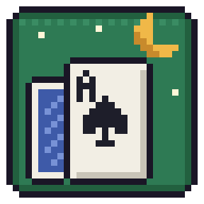
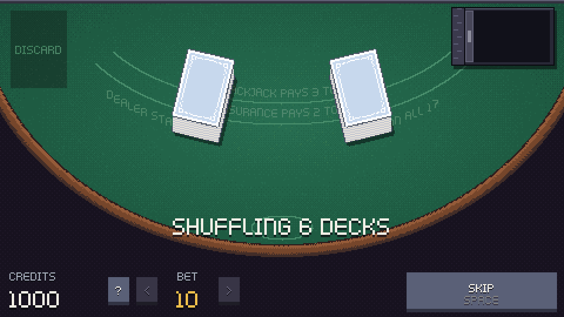

# Hushjack



A small pixel-art blackjack table for one player, written in Rust. It opens
straight into the game. A dealer hand-shuffles 6 decks the way a casino does,
you cut, and you play from the shoe for as long as you like.



## Download

Get the build for your system from the
[releases page](https://github.com/hugoocoto/blackjack/releases), unpack it and
run `hushjack`. The game is a single file.

- **Windows:** the game isn't signed, so SmartScreen may warn you. Click
  *More info*, then *Run anyway*.
- **macOS:** the game isn't signed either, so macOS blocks it the first time.
  Run `xattr -d com.apple.quarantine hushjack` in the unpacked folder, or
  allow it in *System Settings → Privacy & Security*. The build works on
  Apple Silicon and Intel Macs.
- **Linux:** x86_64 only. It needs ALSA (`libasound2`), which most desktops
  already have. Run `./install.sh` in the unpacked folder to add it to your
  menu (it installs into `~/.local`, no root needed; `./install.sh --uninstall`
  removes it).

With Rust installed, you can also get it from [crates.io](https://crates.io/crates/hushjack):

```sh
cargo install hushjack
hushjack --install-desktop   # optional: add it to your app menu (Linux)
```

`hushjack --uninstall-desktop` removes the menu entry again.

On Linux this needs the ALSA development files (`libasound2-dev` on
Debian/Ubuntu, `alsa-lib-devel` on Fedora, `alsa-lib` on Arch).

## Play

To build it yourself instead:

```sh
cargo run --release
```

To install your own build into `~/.local` with a menu entry, run
`cargo build --release` and then `packaging/linux/install.sh`.

| Key | Action |
| --- | --- |
| `Space` | Deal, stand, decline insurance, skip the shuffle |
| `H` `S` `D` `P` | Hit, stand, double, split |
| `I` / `N` | Take or decline insurance |
| `←` `→` or mouse wheel | Change your bet |
| `C` | Show or hide the strategy chart |
| `F` | Fullscreen |
| `Esc` | Quit |

You can also click every button. To cut, move the cut card with the mouse
or the arrow keys, then click.

## Rules

- 6 decks. Blackjack pays 3:2. The dealer stands on all 17s and peeks for
  blackjack.
- You can double on any two cards, including after a split. You can split
  up to 4 hands. Split aces get one card each.
- Insurance is offered when the dealer shows an Ace. It costs half your bet
  and pays 2:1.
- There is no surrender.
- You start with 1000 credits. Your balance can go negative, and the game
  never ends.
- The dealer's cut card sits about one deck from the end. When it comes
  out, that hand is the last one, and then the dealer shuffles again.

The strategy chart (`C`) shows basic strategy for these rules. During your
turn, it marks the play for your hand.

## Requirements

Rust (stable). On Linux, sound needs ALSA.

## Credits

The cards, sounds and font are by [Kenney](https://kenney.nl), under the CC0
license. The license files are in `assets/licenses/`.

## License

The code is licensed under the GNU General Public License, version 3 or
later. See [LICENSE](LICENSE).
